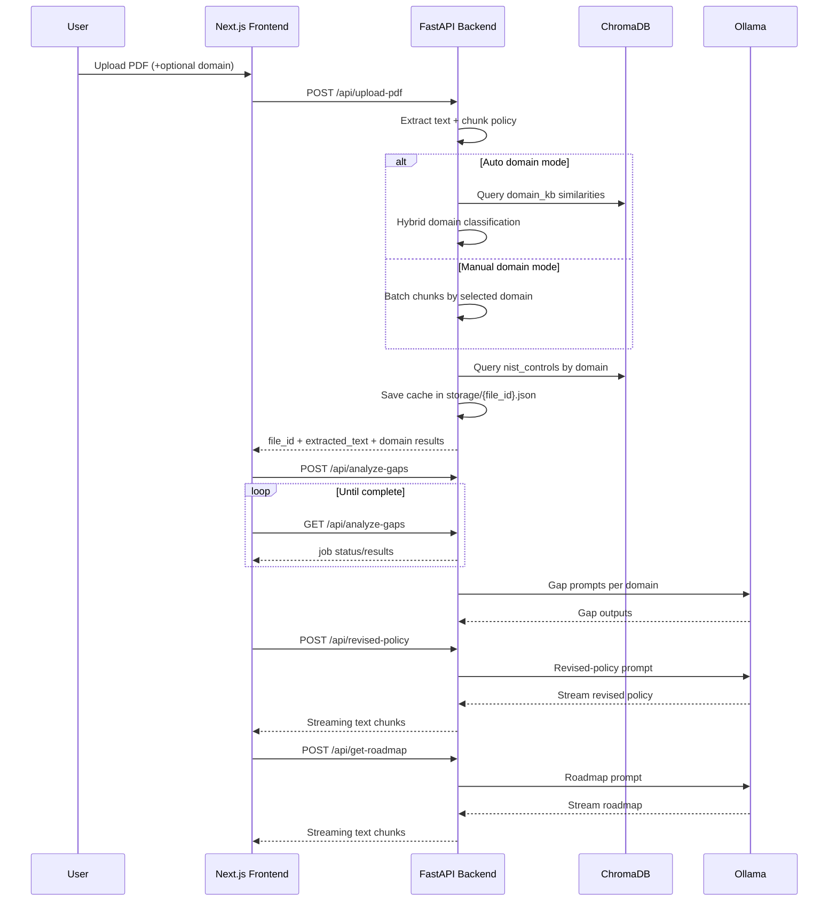

# PolicyGuard AI — Complete System Flow Overview

## 1) System Purpose
PolicyGuard AI analyzes an uploaded organization policy PDF against NIST-aligned controls, identifies compliance gaps, generates a revised policy, and then builds an implementation roadmap.

---

## 2) High-Level Architecture

### Frontend (Next.js)
- Path: `src/`
- Key pages:
  - `/` → upload and domain selection
  - `/analysis` → gap analysis status/results
  - `/revised-policy` → streamed revised policy generation
  - `/roadmap` → streamed implementation roadmap generation
  - `/nist-policies` → static NIST template library reference

### Backend (FastAPI)
- Path: `backend/`
- Entry point: `backend/main.py`
- API prefix: `/api`
- Core routes:
  - `POST /api/upload-pdf`
  - `POST /api/analyze-gaps` + `GET /api/analyze-gaps` (poll status)
  - `POST /api/revised-policy` (streaming)
  - `POST /api/get-roadmap` (streaming)
  - `GET /api/get-analysis/{file_id}`

### AI/Vector Dependencies
- Ollama (`mistral`) for generation and streaming
- SentenceTransformer (`all-MiniLM-L6-v2`) for embeddings
- ChromaDB collections:
  - `domain_kb` for domain classification support
  - `nist_controls` for related policy retrieval

---

## 3) Startup and Initialization Flow

1. **Backend startup (`backend/main.py`)**
   - Configures logging
   - Enables permissive CORS
   - Ensures directories exist:
     - `backend/uploads`
     - `backend/storage`

2. **LLM health**
   - `GET /check-llm` tests `http://localhost:11434`
   - If unavailable, attempts `ollama serve`

3. **Embedding model provisioning (one-time / setup)**
   - `python backend/download_embedding_model.py`
   - Saves model into `backend/models/all-MiniLM-L6-v2`

4. **Chroma ingestion (setup phase)**
   - `python -m ingestion.ingest_domain_data` populates `domain_kb`
   - `python -m ingestion.ingest_nist` populates `nist_controls`

---

## 4) Offline Knowledge Preparation Flow (Ingestion)

### 4.1 Domain KB ingestion (`backend/ingestion/ingest_domain_data.py`)
1. Reads `backend/ingestion/domain_data.json`
2. For each domain phrase in `kb`, computes embedding
3. Upserts into Chroma collection `domain_kb` with metadata `{ domain }`

### 4.2 NIST controls ingestion (`backend/ingestion/ingest_nist.py`)
1. Reads `backend/ingestion/chunks_of_nist.json`
2. Embeds each NIST chunk text
3. Upserts into Chroma collection `nist_controls` with metadata:
   - `domain`
   - `source`

This prepared data powers runtime domain classification and NIST retrieval during upload processing.

---

## 5) End-to-End Runtime Flow (User Journey)

## Step A — Upload and preprocess policy PDF
Frontend page: `/` (upload UI in `src/features/upload/UploadZone.tsx`)

1. User selects optional domain or leaves auto mode.
2. User uploads PDF.
3. Frontend calls `POST /api/upload-pdf` (multipart form-data):
   - `file`: PDF
   - `domain` (optional)

### Backend processing in `upload_route.py`
1. Validates file existence and `.pdf` extension.
2. Reads file bytes.
3. Generates deterministic `file_id` (MD5 + optional domain suffix).
4. Saves original file to `backend/uploads/`.
5. Extracts text via `pdfplumber` (`helpers/pdf_helper.py`).
6. Checks cache (`backend/storage/{file_id}.json`):
   - If found: returns cached result + extracted text.
7. Chunks text (`helpers/chunking_helper.py`) using token-aware sentence chunking.
8. Builds domain-wise chunks:
   - **Manual domain mode:** batch chunks into balanced groups (`CHUNKS_PER_BATCH=4`).
   - **Auto mode:** classify each chunk with hybrid score:
     - semantic score from Chroma `domain_kb`
     - keyword score from `domain_data.json`
     - weighted combine (`0.6 semantic + 0.4 keyword`)
     - optional multi-domain assignment when top-score gap is below threshold.
9. Retrieves related NIST policies per domain from Chroma `nist_controls`.
10. Saves result JSON in `backend/storage/` for reuse.
11. Returns payload:
   - `file_id`
   - `cached`
   - `result` (domain chunks + related NIST policies)
   - `extracted_text`

### Frontend persistence after upload
`src/app/page.tsx` stores in `localStorage`:
- `uploadedDomains`
- `extractedText`
- `fileId`

Then navigates to `/analysis`.

---

## Step B — Gap analysis generation
Frontend page: `/analysis`

1. Reads `uploadedDomains` + `fileId` from `localStorage`.
2. Starts analysis with `POST /api/analyze-gaps`.
3. Polls `GET /api/analyze-gaps` every 15 seconds until done.
4. Caches progress/results in `localStorage` key:
   - `gapAnalysis:<fileId>`

### Backend behavior (`gaps_route.py` + `gaps_service.py`)
1. Uses global `current_job` state.
2. Rejects concurrent start if existing status is `processing`.
3. Runs worker in FastAPI background task.
4. For each domain item:
   - Formats organization chunk text
   - Formats retrieved NIST reference text
   - Calls LLM (`call_llm`) with `GAP_ANALYSIS_PROMPT`
   - Stores per-domain status + gaps in `current_job.results`
5. Updates job counters (`completed`, `total`) and final status (`completed`/`failed`).

### Gap output expectations
Prompt requests concise gap array (3–5 items, specific and actionable), without JSON wrappers.

---

## Step C — Revised policy generation (streaming)
Frontend page: `/revised-policy`

1. Reads from `localStorage`:
   - `extractedText`
   - `gapAnalysis:<fileId>`
2. Builds combined gap text grouped by domain.
3. Calls `POST /api/revised-policy` with JSON:
   - `text`
   - `gap_analysis`
4. Consumes streaming response chunks and appends text live.
5. Saves final output to:
   - `revisedPolicy:<fileId>`

### Backend behavior (`revision_route.py`)
1. Validates non-empty `text` and `gap_analysis`.
2. Formats `REVISED_POLICY_PROMPT`.
3. Streams tokens/chunks from `stream_llm(...)` as `text/event-stream`.

---

## Step D — Implementation roadmap generation (streaming)
Frontend page: `/roadmap`

1. Reads from `localStorage`:
   - `extractedText` (original)
   - `revisedPolicy:<fileId>`
2. Calls `POST /api/get-roadmap` with JSON:
   - `input_policy`
   - `revised_policy`
3. Reads and renders streamed chunks.
4. Saves final output to:
   - `roadmap:<fileId>`

### Backend behavior (`roadmap_route.py`)
1. Validates request JSON and required fields.
2. Formats `ROADMAP_PROMPT`.
3. Streams roadmap text from `stream_llm(...)`.

---

## 6) LLM Service Flow (`helpers/llm_helper.py`)

### Non-streaming calls (`call_llm`)
1. Ensures Ollama service is reachable (starts it if needed).
2. Sends prompt to Ollama generate endpoint (`/api/generate`) with model `mistral`.
3. Attempts JSON parse of response body string.
4. Falls back to raw stripped text if parse fails.

### Streaming calls (`stream_llm`)
1. Ensures Ollama service is running.
2. Opens `ollama.chat(..., stream=True)`.
3. Yields partial content chunks progressively.

---

## 7) Data Storage and Caching Strategy

### Server-side storage
- Folder: `backend/storage/`
- File naming: `{file_id}.json`
- `file_id` deterministic from PDF bytes (+ optional domain), enabling reuse for same input.

### Client-side storage (`localStorage`)
- `uploadedDomains`
- `extractedText`
- `fileId`
- `gapAnalysis:<fileId>`
- `revisedPolicy:<fileId>`
- `roadmap:<fileId>`

This supports resumable UI behavior and reduces repeated LLM calls.

---

## 8) Core API Contracts (Observed)

### `POST /api/upload-pdf`
- **Input:** multipart (`file`, optional `domain`)
- **Output:**
  - `file_id: string`
  - `cached: boolean`
  - `result: Array<{domain, text, related_nist_policies}>`
  - `extracted_text: string`

### `POST /api/analyze-gaps`
- **Input:** array of domain objects from upload result
- **Output:** current job object (`status`, `results`, counters)

### `GET /api/analyze-gaps`
- **Output:** latest global job state

### `POST /api/revised-policy`
- **Input:** `{ text: string, gap_analysis: string }`
- **Output:** streamed text response

### `POST /api/get-roadmap`
- **Input:** `{ input_policy: string, revised_policy: string }`
- **Output:** streamed text response

### `GET /api/get-analysis/{file_id}`
- **Output:** cached server analysis for that file_id

---

## 9) Sequence Diagram (Conceptual)

---

## 10) Error Handling and Operational Notes

- Upload rejects missing/non-PDF files.
- Revised-policy and roadmap routes validate required fields.
- Gap analysis is single-active-job due to global `current_job` state.
- Streaming endpoints return partial content progressively (better UX for long responses).
- Cache-first behavior on upload avoids repeated preprocessing and retrieval work.

---

## 11) Important Constraints / Characteristics

1. **Single process shared state for gap jobs**
   - `current_job` is in-memory global state; concurrent users share the same job context.

2. **Localhost-coupled integrations**
   - Ollama expected at `localhost:11434`
   - Chroma expected at `localhost:8000`

3. **Frontend-backend URL assumptions**
   - Frontend currently calls hardcoded backend URLs (`127.0.0.1:5000` / `localhost:5000`).

4. **Output format dependence on prompts**
   - Gap/revision/roadmap quality and structure are prompt-driven.

---

## 12) Flow Summary in One Line

**Upload PDF → extract/chunk/classify → retrieve NIST references → run gap analysis (polled) → stream revised policy → stream implementation roadmap, with both server-side and browser-side caching for reuse.**
